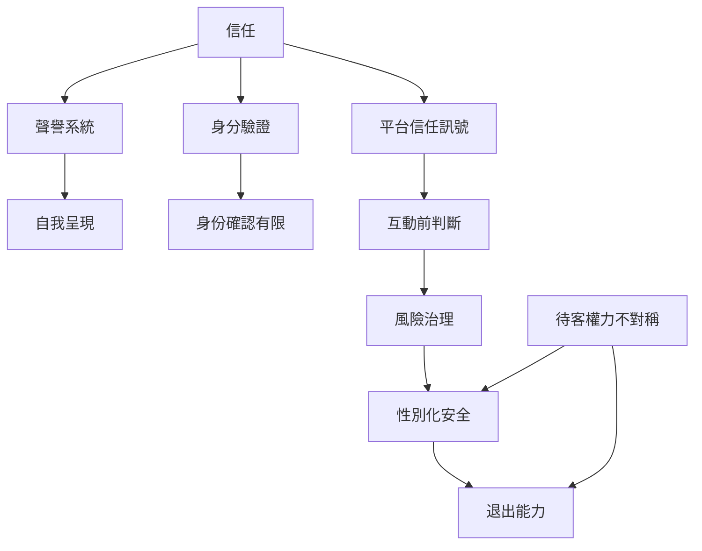

信任不是單一徽章，而是多種線索、實際互動與制度性保護的組合。此圖也將評價的局限、退出能力與性別化風險放在同一張圖中。

## 延伸閱讀
- [[信任]]
- [[聲譽系統]]
- [[身分驗證]]
- [[平台信任訊號]]
- [[風險治理]]
- [[性別化安全]]
- [[待客權力不對稱]]
- [[關係界線]]
- [[平台責任]]
- [[信任依靠多個弱訊號而非單一驗證徽章]]
- [[安全不能由評價與身份徽章保證]]
- [[把住宿安全設計成可退出的分層流程]]

本書索引：[[CouchSurfing]]。
