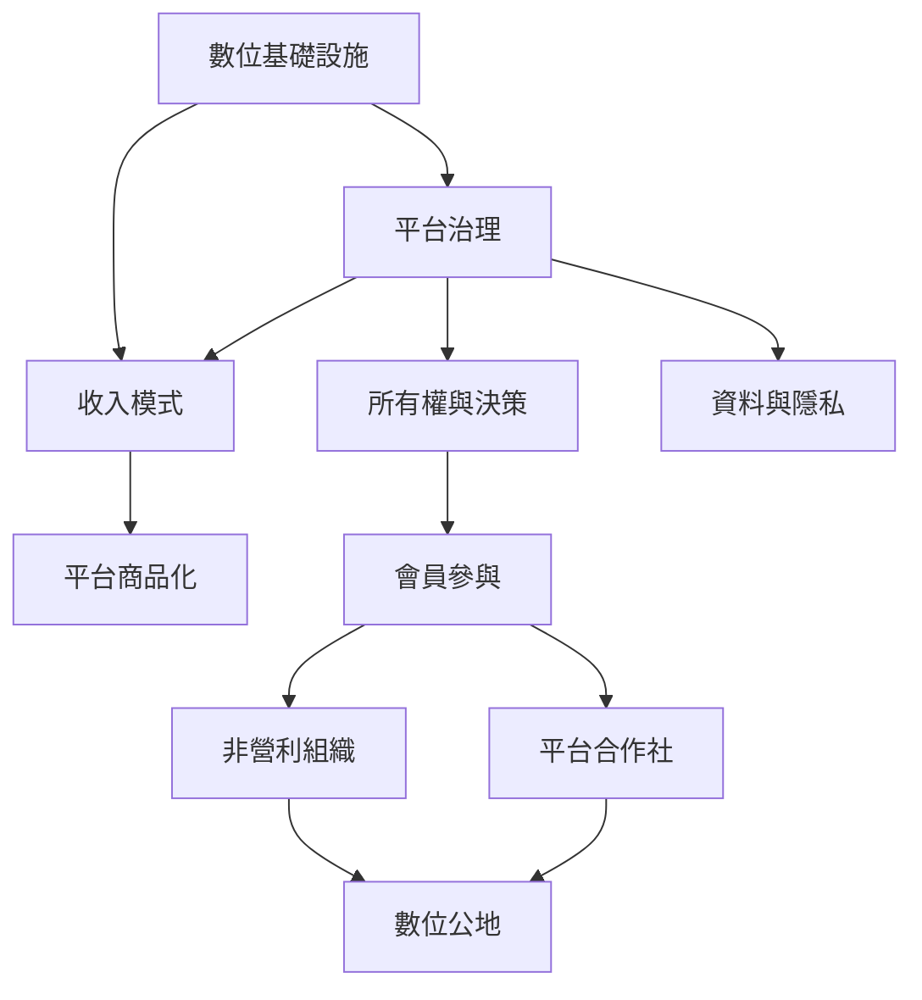

平台的商業模式、所有權與會員參與會影響共同體如何理解自己。此圖適合比較公司治理、非營利模式與數位公地。

## 延伸閱讀
- [[平台治理]]
- [[平台商品化]]
- [[平台合作社]]
- [[數位公地]]
- [[平台責任]]
- [[數位基礎設施]]
- [[社會再生產]]
- [[平台治理會改變社群成員對互助承諾的理解]]
- [[比較 Couchsurfing BeWelcome 與 Trustroots 的共同治理模式]]
- [[建立不靠商業平台的地方待客公地]]

本書索引：[[CouchSurfing]]。
