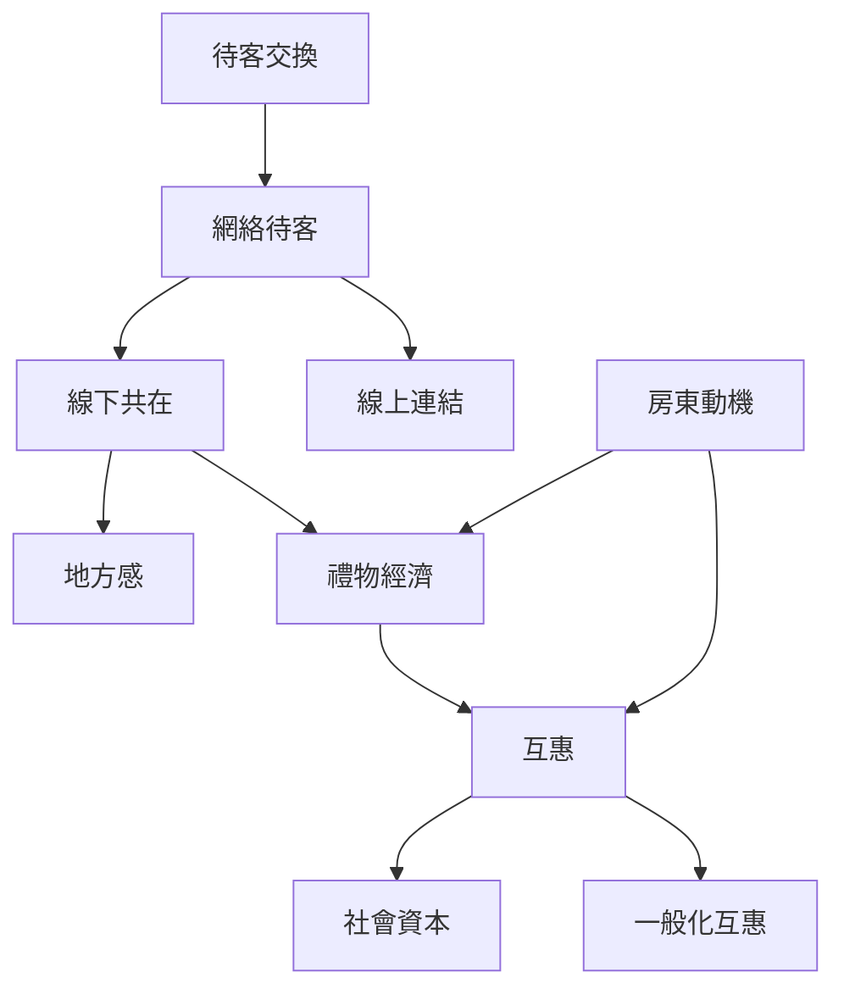

本圖把 Couchsurfing 的核心從「免費住宿」拆解成待客、互惠與共同生活。可由平台機制一路追到線下關係，再觀察禮物與社會資本如何流動。

## 延伸閱讀
- [[待客交換]]
- [[網絡待客]]
- [[互惠]]
- [[一般化互惠]]
- [[禮物經濟]]
- [[社會資本]]
- [[文化交換]]
- [[地方感]]
- [[替代性旅行]]
- [[待客不只是提供床位而是共同創造一段關係]]
- [[互惠不必即時對等而能在陌生人網絡中延遲流動]]
- [[房東也能透過接待獲得替代性旅行與世界連結]]

本書索引：[[CouchSurfing]]。
