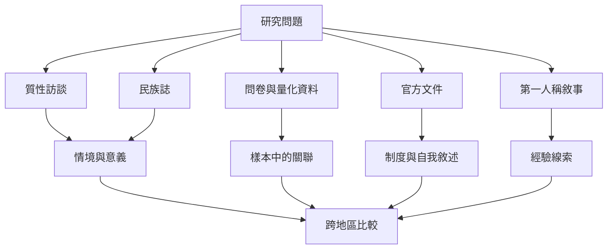

本主題的證據包括質性訪談、民族誌、問卷、跨國比較、官方政策與個人論壇敘事。不同材料能回答的問題不同，引用時要保留方法限制。

## 延伸閱讀
- [[經驗知識]]
- [[地方化實踐]]
- [[台灣個案顯示全球待客模式會被在地文化重新協商]]
- [[中國 Couchsurfing 的信任形成受到關係文化影響]]
- [[伊朗房東透過接待獲得替代性旅行與跨文化學習]]
- [[巴西與葡萄牙旅客都重視文化交流但成本動機不同]]
- [[土耳其旅遊樣本顯示參與 Couchsurfing 與目的地熟悉度提升相關]]
- [[女性旅客的騷擾敘事揭示評價制度可能看不見的權力問題]]

本書索引：[[CouchSurfing]]。
