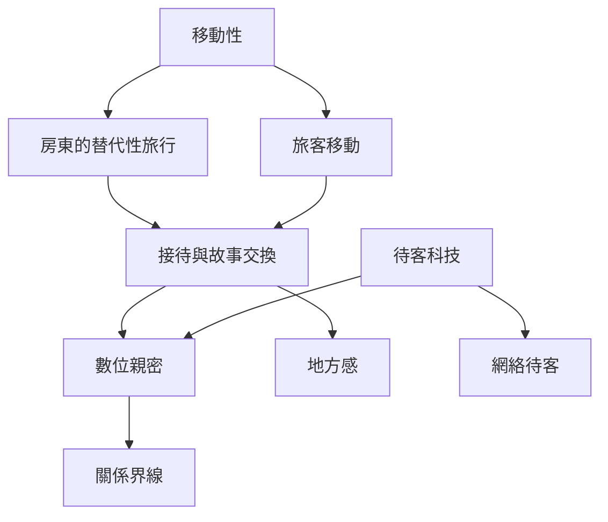

旅遊研究常以旅客為中心；房東也可能透過接待與社群活動經驗跨文化移動。此圖連結數位媒介、親密關係與地方生活。

## 延伸閱讀
- [[移動性]]
- [[替代性旅行]]
- [[數位親密]]
- [[待客科技]]
- [[網絡待客]]
- [[關係界線]]
- [[地方感]]
- [[社群歸屬]]
- [[房東也能透過接待獲得替代性旅行與世界連結]]
- [[把接待視為低移動生活中的替代性旅行]]

本書索引：[[CouchSurfing]]。
