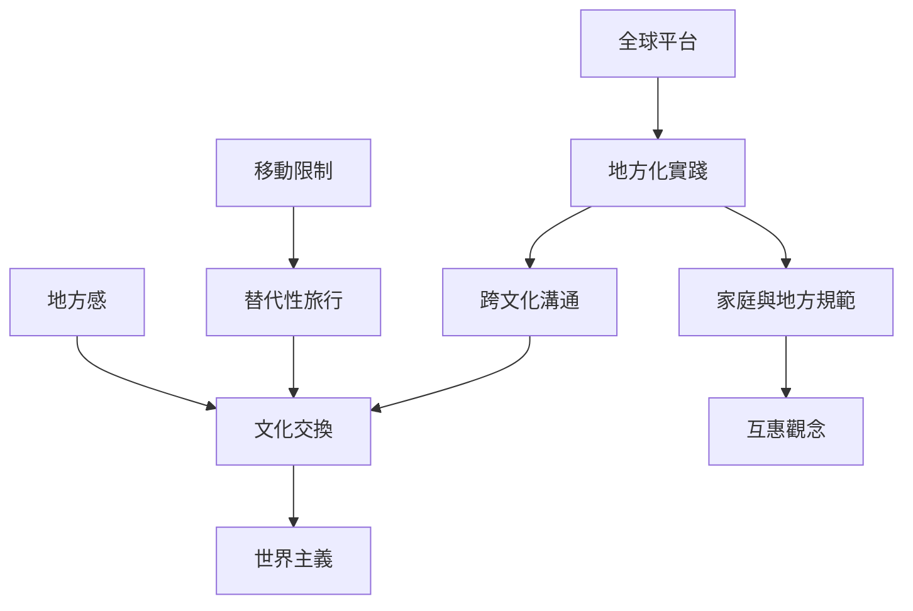

Couchsurfing 是全球平台，但待客規則必須在不同地方脈絡中被重新協商。此圖把地方化、文化交換、世界主義與移動限制放在一起閱讀。

## 延伸閱讀
- [[地方化實踐]]
- [[跨文化溝通]]
- [[文化交換]]
- [[世界主義]]
- [[移動性]]
- [[替代性旅行]]
- [[旅遊動機]]
- [[地方感]]
- [[互惠]]
- [[全球平台在地方生活中會產生不同的待客樣式]]
- [[跨文化待客規則必須明示而不能假設彼此自然相同]]
- [[訪談台灣房東如何定義熱情與互惠]]

本書索引：[[CouchSurfing]]。
