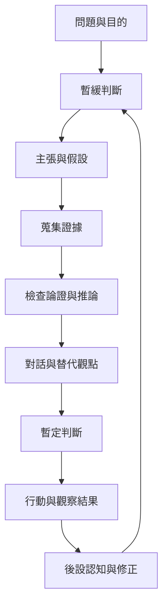

批判性思考可理解為一個反覆循環：釐清目的與問題、暫緩立即判斷、提出主張與假設、蒐集領域相關證據、檢查推論、聽取其他觀點、決定行動，再根據結果修正。它不是僵硬的線性步驟，而是允許在新資料出現時回到任何環節。

本圖以 [[反思性思考]] 為起點，連接 [[懸置判斷]]、[[主張]]、[[證據]]、[[論證]]、[[推論]] 與 [[後設認知]]。此流程也可與 [[批判性思考需連結反思與行動]] 和 [[暫緩結論能讓懷疑轉化為持續探究]] 交叉閱讀。

### 參考
* [[批判性思考是一種以目標為導向的審慎判斷]]
* [[杜威把反思思考視為暫緩判斷後的持續探究]]
* [[教學批判思考的統合分析支持對話與真實問題]]
