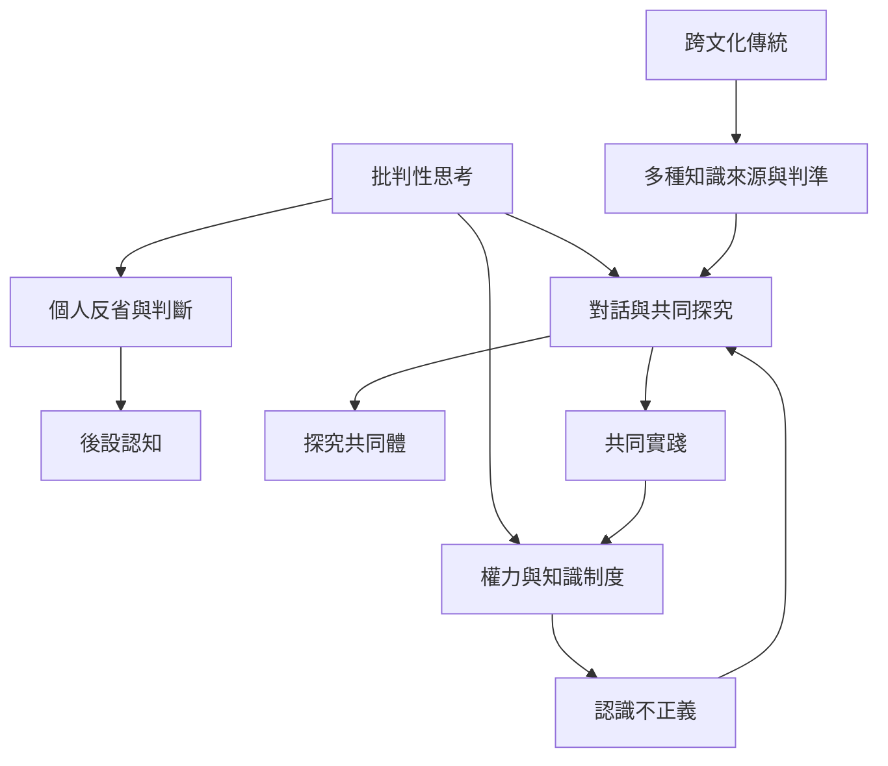

批判性思考的教育與應用必須檢查知識如何被生產、傳播與認可。Freire 的批判教育關注教育與權力、對話及社會改變；儒家思想中的反省學習、印度哲學的知識來源分析、佛教經典的實踐檢驗，以及非洲脈絡的認識正義，則提供不同的問題意識。

跨文化比較應避免把各種傳統化約成單一的「批判思考」，也不能以一篇研究代表整個地區。與 [[多元知識傳統拓寬何謂合理與證據]]、[[批判性思考也必須檢查自身價值與權力位置]] 及 [[批判性思考需連結反思與行動]] 互相連結。

### 參考
* [[Paulo Freire訪談呈現批判意識與對話式教育]]
* [[孔子思想中的學習包含反省與自主判斷]]
* [[印度哲學的知識論以知識來源與正當化為核心]]
* [[迦羅摩經的檢驗精神不等於只相信個人直覺]]
* [[非洲脈絡的認識正義研究質疑單一標準化評量]]
