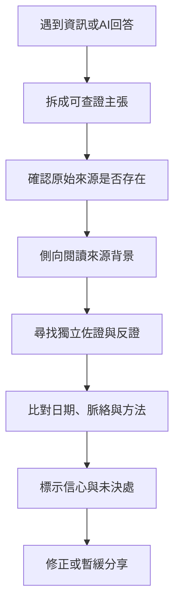

數位資訊環境的風險不只是錯誤內容，也包括來源偽裝、演算法放大、情緒操弄、斷章取義與 AI 生成的虛構引文。有效流程包括辨識主張、回到原始資料、側向閱讀來源背景、找獨立佐證、比對日期與脈絡，再標示目前信心。

[[側向閱讀]] 是查核來源的重要方法；[[媒體與資訊素養]] 則涵蓋平台、科技與倫理層面。AI 可協助提出可能答案，但需遵循 [[AI應降低搜尋負擔而非外包判斷]] 的原則。

### 參考
* [[查核者使用側向閱讀比留在原網站更能判斷可信度]]
* [[UNESCO媒體與資訊素養課程把批判判讀連結到數位公民]]
* [[生成式AI改變知識工作者的批判思考工作分配]]
