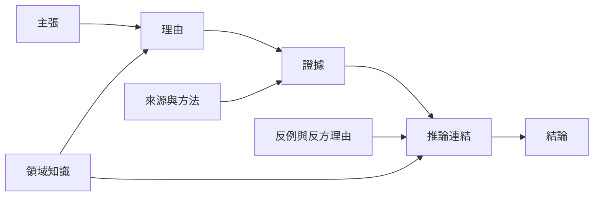

論證品質控制的核心，是讓每個推論環節都能被看見與質疑。主張需要清楚、理由需要相關、證據需要可靠，且推論必須能從前提走向結論。若論證依賴類比、權威或統計資料，還需檢查相似性、專業資格、抽樣與不確定性。

可透過 [[論證地圖]] 展示結構，但圖示只是協助檢查的工具，不是可靠性的保證。與 [[有效性與健全性]]、[[證據]]、[[推論]] 及 [[正理派五支論式展示主張理由例證與結論的連結]] 雙向參照。

### 參考
* [[論證品質取決於前提與證據而非語氣]]
* [[正理派五支論式展示主張理由例證與結論的連結]]
* [[論證地圖研究呈現視覺化推理的研究範圍]]
