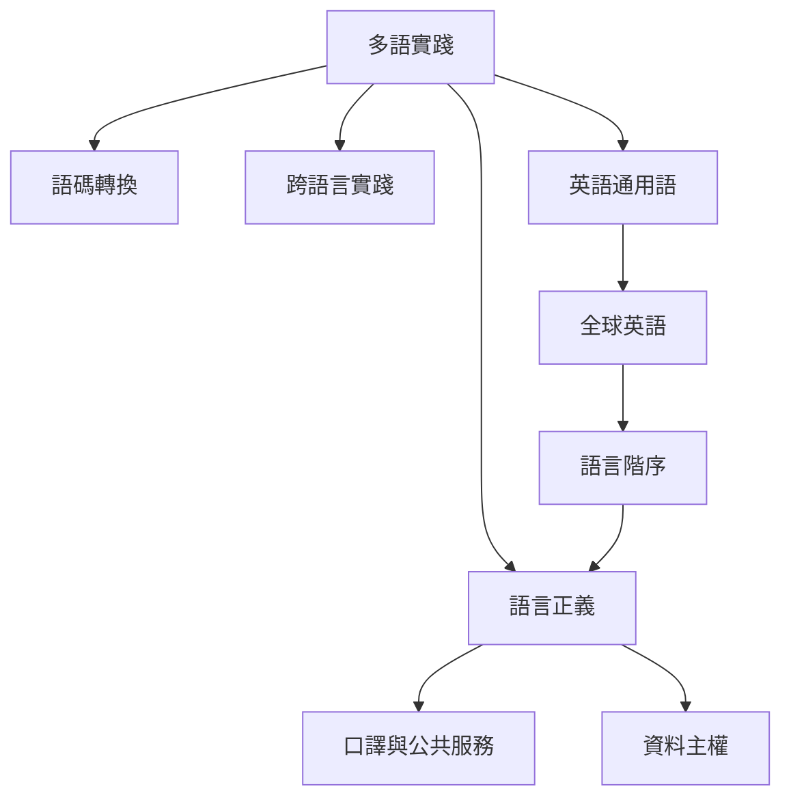

語言不只是傳遞工具，也是身份、制度資源與權力的分配方式。多語溝通需要看見各種語言資源，也需要處理語言階序。

概念：[[英語通用語]]、[[全球英語]]、[[多語實踐]]、[[語碼轉換]]、[[跨語言實踐]]、[[語言正義]]、[[語言帝國主義]]。

永久筆記：[[英語通用語是互動資源而非單一標準變體]]、[[多語實踐能擴大共同理解的路徑]]、[[文化差異的解釋必須納入權力與歷史]]、[[口譯服務是公共服務可近性的基礎設施]]、[[數位跨文化溝通需要資料主權與社群治理]]。

靈感延伸：[[多語聚會可以用重述與回聲確認建立共同理解]]、[[跨文化會議應把語言權力列入議程與流程設計]]、[[語言科技專案應先設計社群資料治理再設計模型]]。

本概念地圖屬於 [[Cross-cultural_communication]]。
