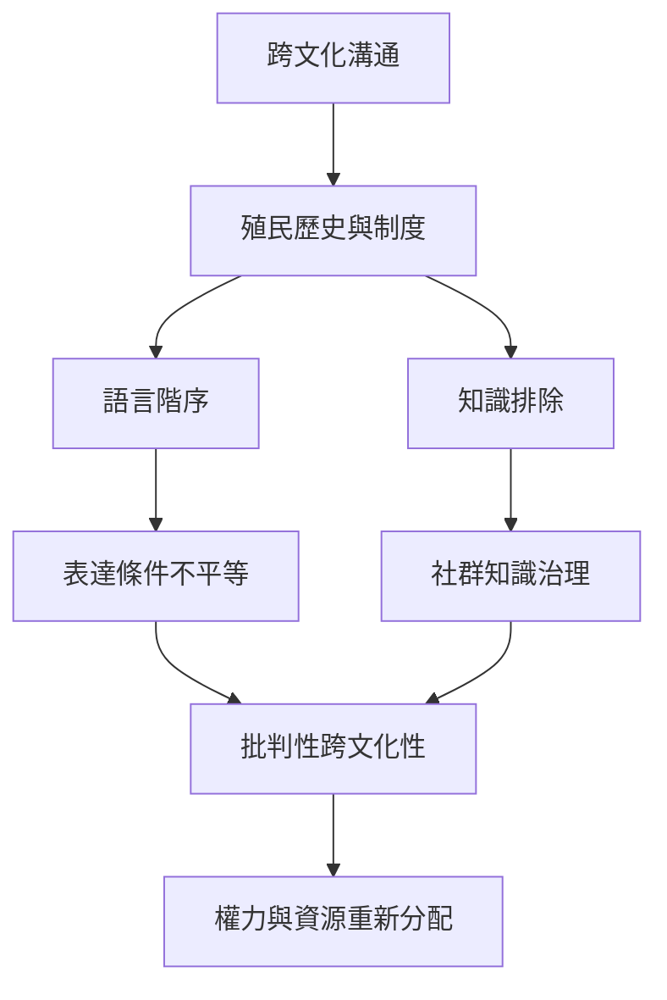

此圖把跨文化溝通放回歷史、政策、知識生產和技術治理中，避免把結構問題縮減成個人態度或禮貌技巧。

概念：[[批判性跨文化性]]、[[語言正義]]、[[文化謙遜]]、[[民族中心主義]]、[[Talanoa]]、[[身份協商]]。

永久筆記：[[文化差異的解釋必須納入權力與歷史]]、[[真正的對話需要平等的表達條件]]、[[跨文化教育需要社群參與知識治理]]、[[數位跨文化溝通需要資料主權與社群治理]]。

靈感延伸：[[跨文化對話的成果應追蹤決策權是否真的被重新分配]]、[[跨文化活動可以採用關係優先的 Talanoa 式對話設計]]。

本概念地圖屬於 [[Cross-cultural_communication]]。
