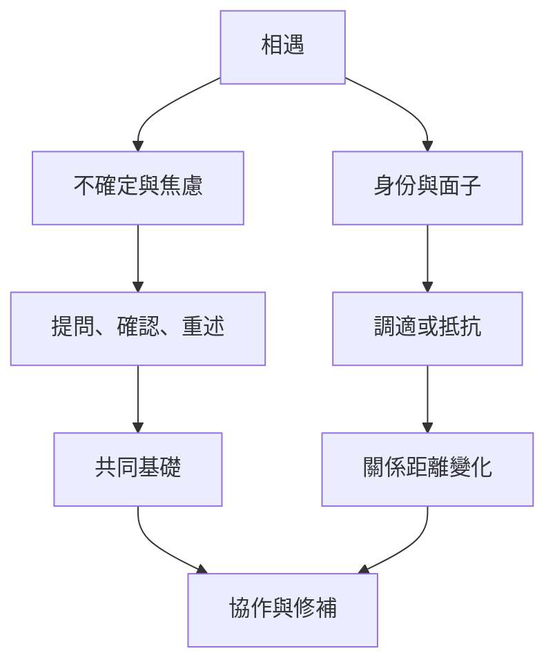

互動不是單向傳遞，而是參與者持續調整、理解、協商面子並管理不確定性的過程。

概念：[[面子工作]]、[[溝通調適理論]]、[[焦慮與不確定性管理]]、[[共同基礎]]、[[身份協商]]、[[文化謙遜]]、[[言語行為]]。

永久筆記：[[共同基礎是在互動中逐步建立的]]、[[面子是關係中的身份協商而不是固定民族特質]]、[[禮貌是互動序列而不是固定規則清單]]、[[語言調適既能建立親近也能重申權力差距]]、[[不確定感可以透過提問與共同校準來管理]]、[[跨文化溝通能力包含對自身調整方式的覺察]]。

靈感延伸：[[多語聚會可以用重述與回聲確認建立共同理解]]、[[沉默與打斷都應放回話輪序列理解]]。

本概念地圖屬於 [[Cross-cultural_communication]]。
