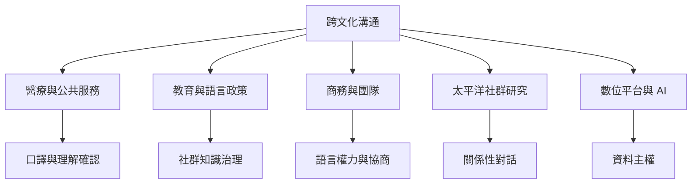

理論可落在醫療、教育、商務、外交、研究、社群和數位平台；各場域的風險與權力配置不同，應避免使用同一套簡化技巧。

概念：[[跨文化溝通]]、[[語用學]]、[[口譯服務]]、[[Talanoa]]、[[英語通用語]]、[[語言正義]]、[[文化謙遜]]。

永久筆記：[[口譯服務是公共服務可近性的基礎設施]]、[[跨文化教育需要社群參與知識治理]]、[[真正的對話需要平等的表達條件]]、[[共同基礎是在互動中逐步建立的]]、[[數位溝通同時受平台規則與文化協商影響]]。

靈感延伸：[[跨文化服務應把口譯與易讀資訊當成基本配置]]、[[跨文化對話的成果應追蹤決策權是否真的被重新分配]]。

本概念地圖屬於 [[Cross-cultural_communication]]。
