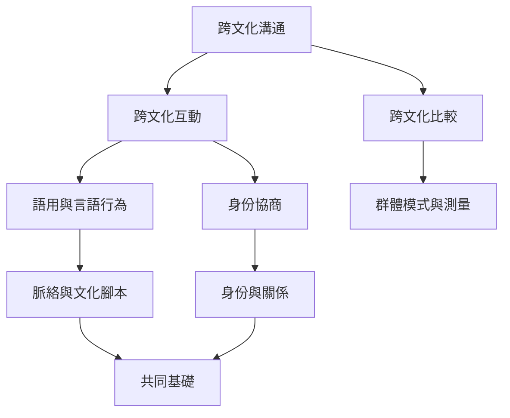

本圖把跨文化溝通分成比較、互動、脈絡與能力幾個互補層次。理論不是用來替人貼標籤，而是為了提出可檢驗的問題。

概念：[[跨文化溝通]]、[[跨文化比較]]、[[跨文化性]]、[[文化]]、[[脈絡]]、[[語用學]]、[[高語境與低語境]]、[[文化腳本]]、[[文化身份]]。

永久筆記：[[跨文化比較與跨文化互動回答的是不同問題]]、[[文化不是封閉一致的國家性格而是多層次實踐]]、[[文化模型只能作為提問工具不能作為人格標籤]]、[[語用意義是在具體互動中共同協商的]]、[[情境線索會隨關係與制度而改變]]。

靈感延伸：[[跨文化對話先問對方如何理解而不是替對方解釋文化]]。

本概念地圖屬於 [[Cross-cultural_communication]]。
