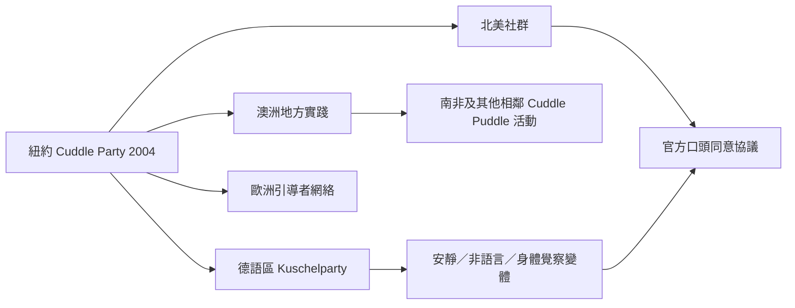

抱抱派對的起源可追溯至 2004 年紐約，之後在德語區形成 Kuschelparty，並出現在加拿大、澳洲、丹麥、比利時、英國、愛爾蘭與南非等地。不同社群採用不同名稱與流程，但多數公開案例重視非性框架、明確界線與參與者自主。

連結：[[抱抱派對]]、[[Kuschelparty]]、[[Cuddle puddle]]、[[觸摸的社會意義取決於文化、關係與場景]]、[[全球抱抱派對會依地方社群調整形式但不應稀釋拒絕權]]。

## 思與行
* 每筆地區案例都需標註來源、查閱日期、活動名稱與是否屬於 Cuddle Party Inc. 認證網絡。
* 對尚缺資料的亞洲與華語地區保持開放，不以搜尋不到等同不存在。

## 參考
* 起源：[[data/抱抱派對創辦人將非性觸摸定位為關係教育與溝通練習]]。
* 全球引導者名錄：[[data/官方引導者名錄呈現抱抱派對已跨越北美與歐洲並延伸至其他地區]]。
* 地方實踐：[[data/德語區將美國 Cuddle Party 轉譯為 Kuschelparty 並發展出地方形式]]、[[data/南非開普敦的 Cuddle Puddle Club 將非性觸摸與參與者篩選結合]]。
