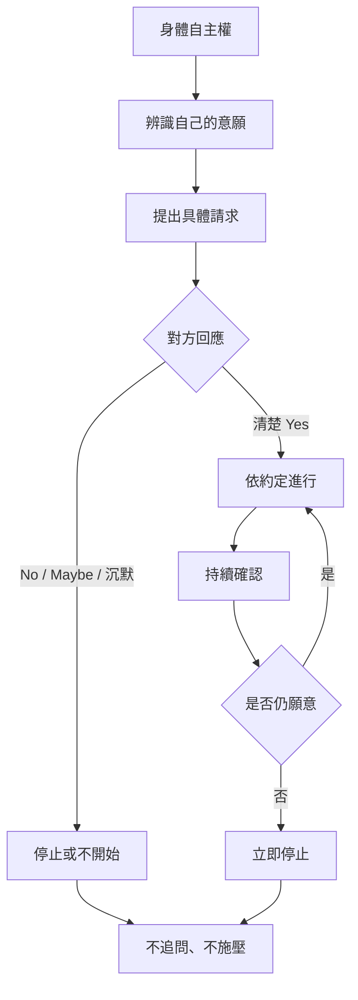

抱抱派對中的同意教育包含辨認意願、具體提出請求、清楚回答、尊重拒絕、辨識不確定與隨時撤回。它不只是活動前簽署一份同意書，而是整段互動中持續發生的協商。

連結：[[同意]]、[[口頭同意]]、[[持續同意]]、[[可撤回同意]]、[[個人界線]]、[[Wheel of Consent]]、[[身體化同意]]、[[拒絕不需要理由也不應引發追問]]、[[同意不是單純允許而是彼此理解意願與責任的協商]]。

## 思與行
* 每次練習都應包含拒絕與撤回，不只練習如何提出邀請。
* 不應以「讓活動更流暢」為理由，略過參與者的確認與選擇。

## 參考
* 研究分析：[[data/Mayr 的民族誌指出抱抱派對是被同意規範包圍的親密遊戲空間]]。
* 官方規則：[[data/官方規範把口頭同意、可拒絕與可改變心意列為抱抱派對核心協議]]。
