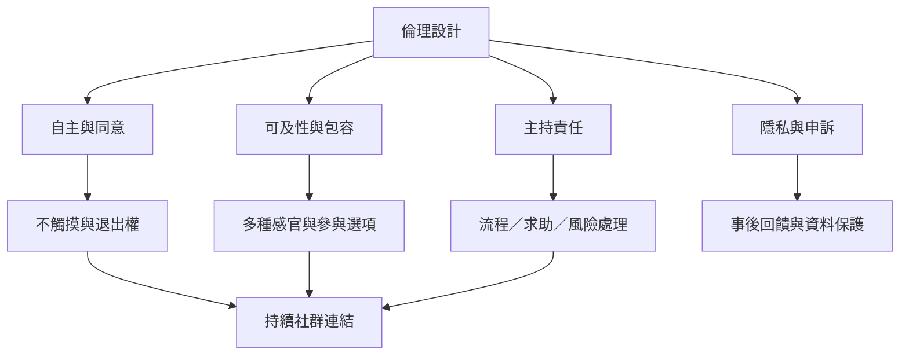

抱抱派對的倫理不只在觸摸當下，也延伸到活動前的資訊、活動中的權力關係、對不同身體需求的可及性，以及活動後的隱私與支持。它可成為社群連結入口，但不應把短暫的親密感變成治療承諾或對參與者的持續依賴。

連結：[[身體自主權]]、[[個人界線]]、[[創傷知情實踐]]、[[安全容器]]、[[抱抱派對可以補充社群連結但不能取代長期照護關係]]。

## 思與行
* 將主持權力納入安全審查，而不只檢查參與者是否遵守規則。
* 為不同感官、行動能力與社交偏好設計多條參與路徑。
* 活動後以自願方式提供其他社群資源，不將參與者綁定為付費會員或私人關係。

## 參考
* 活動實務：[[data/澳洲引導者將抱抱派對的主持工作定位為陪伴而不是修復他人]]。
* 安全原則：[[note/抱抱活動的安全需要程序、權責與可回報管道而不是口號]]。
* 延伸行動：[[idea/把抱抱派對設計成持續社群照顧的入口而不是一次性消費活動]]。
