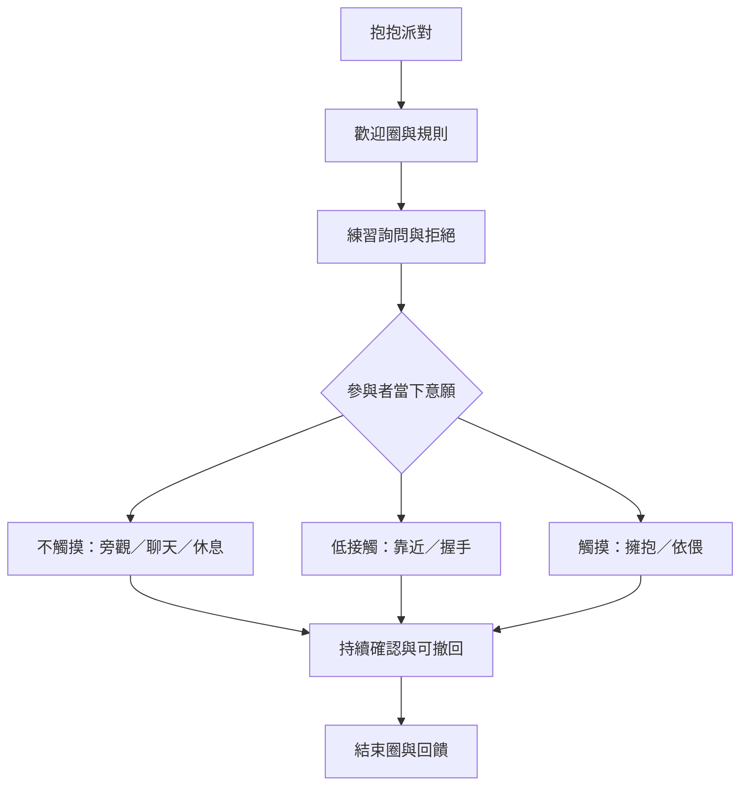

抱抱派對可以理解為一種以同意教育為骨架、以自由選擇為核心的成人社群工作坊。流程的重點不是把每個人帶向擁抱，而是提供可預期的規則、不同程度的參與選項，以及能夠隨時退出的空間。

連結：[[抱抱派對]]、[[口頭同意]]、[[可撤回同意]]、[[不觸摸也應是被承認的完整參與方式]]、[[抱抱活動的安全需要程序、權責與可回報管道而不是口號]]。

## 思與行
* 把「不觸摸」設計成正式選項，而不是例外。
* 活動開始前讓每個人理解流程與求助方式，活動中維持持續同意，活動後留出收尾時間。

## 參考
* 官方流程：[[data/官方規範把口頭同意、可拒絕與可改變心意列為抱抱派對核心協議]]。
* 學術觀察：[[data/Mayr 的民族誌指出抱抱派對是被同意規範包圍的親密遊戲空間]]。
