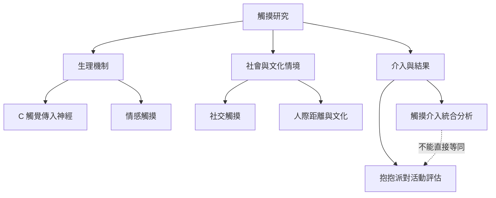

抱抱派對的研究至少包含三個不同層次：觸摸的生理機制、觸摸在人際關係與文化中的意義，以及特定活動是否帶來可測量的結果。這三層可以互相參照，但不能互相替代。

連結：[[社交觸摸]]、[[情感觸摸]]、[[C 觸覺傳入神經]]、[[觸摸介入]]、[[抱抱派對不是經過充分臨床驗證的治療方案]]。

## 思與行
* 所有論證先標記研究對象、介入形式與測量方式，再評估是否能外推至抱抱派對。
* 優先尋找直接研究活動本身的民族誌與評估，而不是以一般擁抱研究替代。

## 參考
* 直接民族誌：[[data/Mayr 的民族誌指出抱抱派對是被同意規範包圍的親密遊戲空間]]。
* 大型統合分析：[[data/2024 年觸摸介入統合分析發現平均效益但沒有直接檢驗抱抱派對]]。
* 跨文化研究：[[data/跨國調查顯示親密觸摸行為會隨文化與關係而改變]]。
