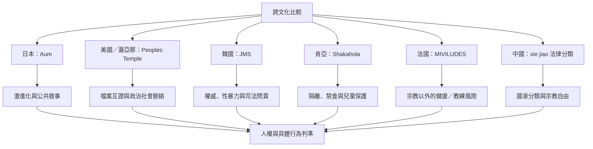

案例比較應保留地區脈絡與證據來源。這張圖將日本、美國／蓋亞那、韓國、肯亞、法國與中國案例連到不同研究問題，而不是把它們當作完全相同的現象。

推薦連結：[[日本 Aum 事件的激進化需要放回團體與社會互動的歷史脈絡]]、[[Jonestown 應以團體自身檔案、政府紀錄與倖存者材料交叉重建]]、[[韓國 JMS 案顯示宗教權威可被用來合理化性侵並削弱成員拒絕能力]]、[[肯亞 Shakahola 事件顯示末日教義與隔離、禁食及制度失靈可能造成致命傷害]]、[[法國以「宗派偏差」框架監測宗教以外的身心健康與教練產業風險]]、[[中國的「邪教」法律分類具有國家治理脈絡，不能直接當作中立學術分類]]。

總導讀：[[Cult]]。
