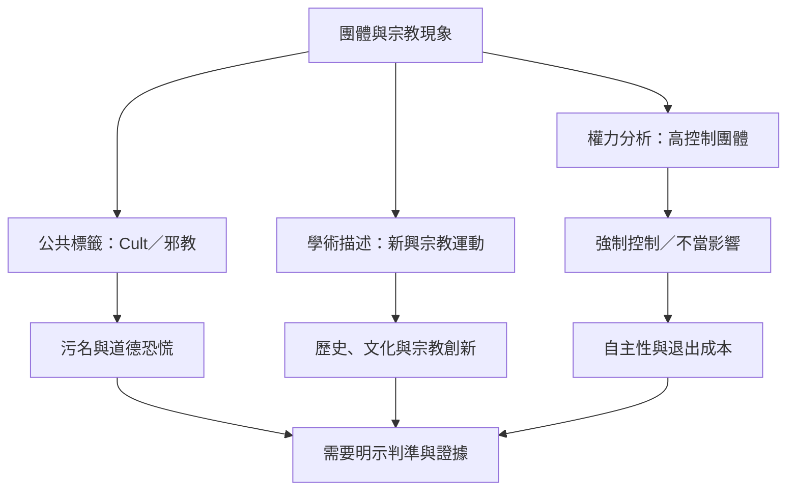

這張圖整理「Cult」「新興宗教運動」與「高控制團體」的不同層次。它們不應互相替代：前者是具爭議的公共標籤，第二者是宗教研究的描述類別，第三者則是分析權力控制的用語。

推薦連結：[[「Cult」是帶有污名的爭議標籤，研究宜先說明使用的判準]]、[[新興宗教運動不等於高控制團體]]、[[以可觀察的權力行為而非信仰異常性評估風險]]。
相關概念：[[Cult（邪教／膜拜團體）]]、[[新興宗教運動]]、[[高控制團體]]、[[強制控制]]、[[不當影響]]。

總導讀：[[Cult]]。
