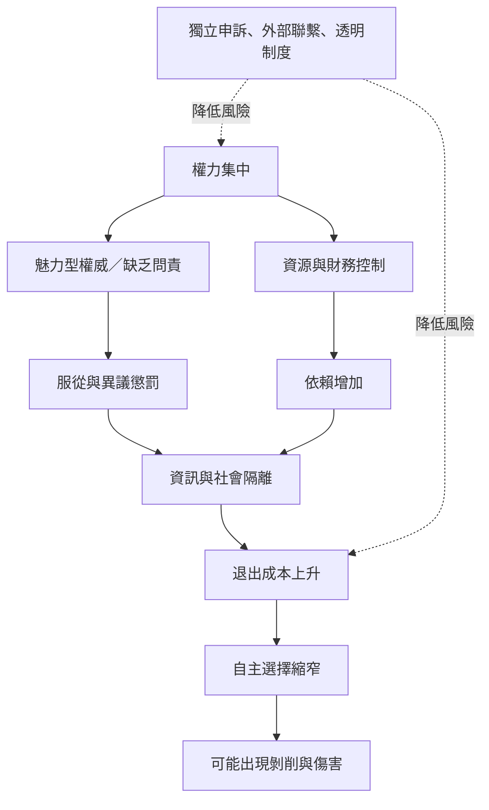

高控制不是單一特徵清單，而是多種權力技術在時間中互相強化的關係。這張圖從領導權威、資源依賴、資訊與關係隔離，連到退出成本與實際傷害。

推薦連結：[[強制控制是累積性行為模式而非單一事件]]、[[高控制團體透過累積性控制縮窄成員選擇]]、[[魅力型權威若缺乏制衡容易演變成個人統治]]。
案例：[[肯亞 Shakahola 事件顯示末日教義與隔離、禁食及制度失靈可能造成致命傷害]]、[[韓國 JMS 案顯示宗教權威可被用來合理化性侵並削弱成員拒絕能力]]。

總導讀：[[Cult]]。
