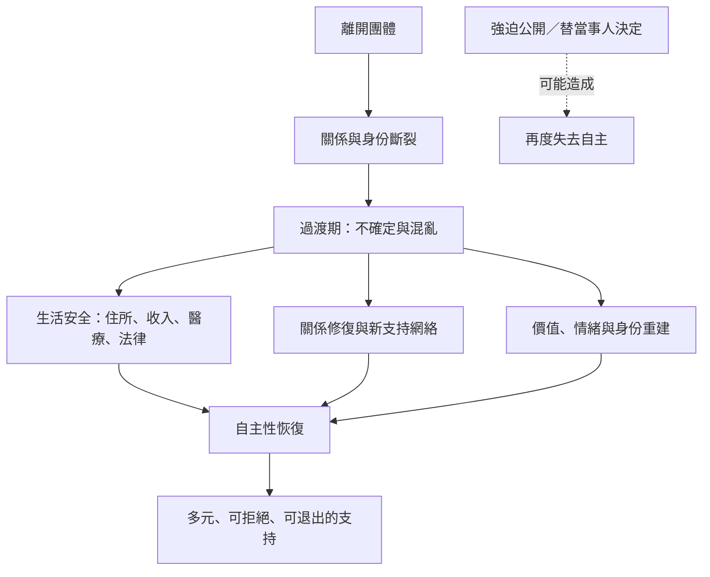

離開高控制團體是持續的社會與文化轉換，不只是停止參與。這張圖呈現外部支持如何協助個人重建安全、關係與選擇。

推薦連結：[[退出團體是一段文化適應與身份重建歷程]]、[[復原支持應恢復自主而不是建立新的依賴]]、[[讓退出成為可行選項是社群健康的重要指標]]、[[建立離開者的多元支持網絡比要求其立刻講出完整受害故事更重要]]。
相關概念：[[退出成本]]、[[身份重建]]、[[社會隔離]]。

總導讀：[[Cult]]。
