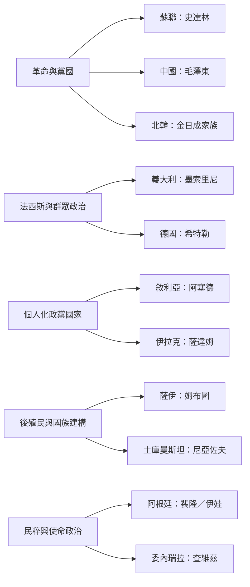

跨區域比較的重點不是建立一份獨裁者名單，而是觀察領袖形象如何與不同歷史條件結合：蘇聯與中國的革命正統性，北韓的世襲制度，義大利與德國的法西斯群眾政治，敘利亞與伊拉克的政黨國家，土庫曼斯坦的後蘇聯國族建構，非洲的反殖民與本真性政治，以及拉丁美洲的民粹使命敘事。

區域研究：[[史達林海報把領袖塑造成父親教師戰士與救世主]]、[[毛澤東崇拜透過修辭儀式與政治競逐逐步擴張]]、[[北韓金日成崇拜經歷外部塑造政治協商與自主擴張]]、[[墨索里尼崇拜結合群眾媒體藝術與政治儀式]]、[[希特勒神話把領袖形象與政權的期待及現實落差連結]]、[[公眾可以不相信領袖神話仍然被迫參與崇拜]]、[[薩達姆崇拜把古代美索不達米亞歷史轉化為領袖合法性]]、[[土庫曼斯坦將領袖崇拜嵌入國族建構與日常生活]]、[[姆布圖的真實性政治把國族文化與個人統治相互綁定]]、[[查維茲的使命政治把魅力領袖塑造成救贖共同體的中心]]、[[伊娃裴隆的公共神話隨階級位置與政治立場而改變]]。

注意：個案資料的密度不均，封閉政體的民眾接受史尤其需要謹慎，不能將官方文本等同於社會共識。
