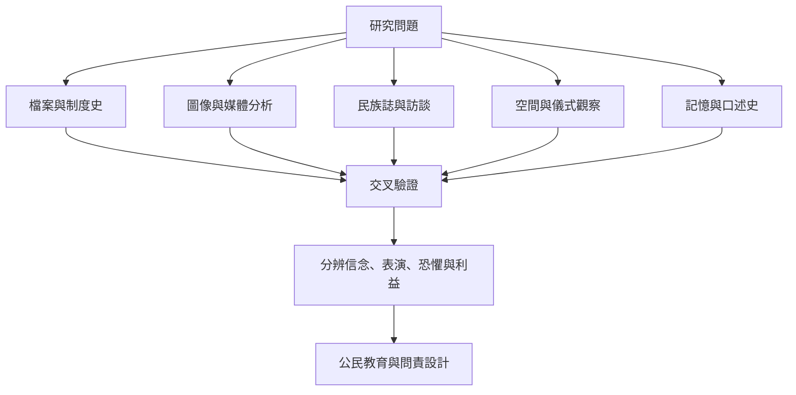

研究領袖崇拜需要跨方法：檔案與制度史追溯官方設計，圖像分析研究領袖如何被呈現，民族誌和訪談理解民眾如何回應，媒體研究追蹤形象流通，記憶研究則觀察政權之後的符號變形。對封閉政體與高壓環境，資料來源、沉默與受訪者風險都必須明確呈現。

研究及行動入口：[[為每個領袖形象追問誰製作誰受益誰被排除]]、[[用相信表演害怕獲益四個維度設計訪談]]、[[製作公共空間領袖肖像地圖看見權力如何佔據日常]]、[[比較反殖民領袖的解放象徵與個人崇拜的界線]]、[[讓政治紀念活動保留拒絕與多元詮釋的空間]]、[[把領袖崇拜與公民領導力教育放在一起比較]]。
