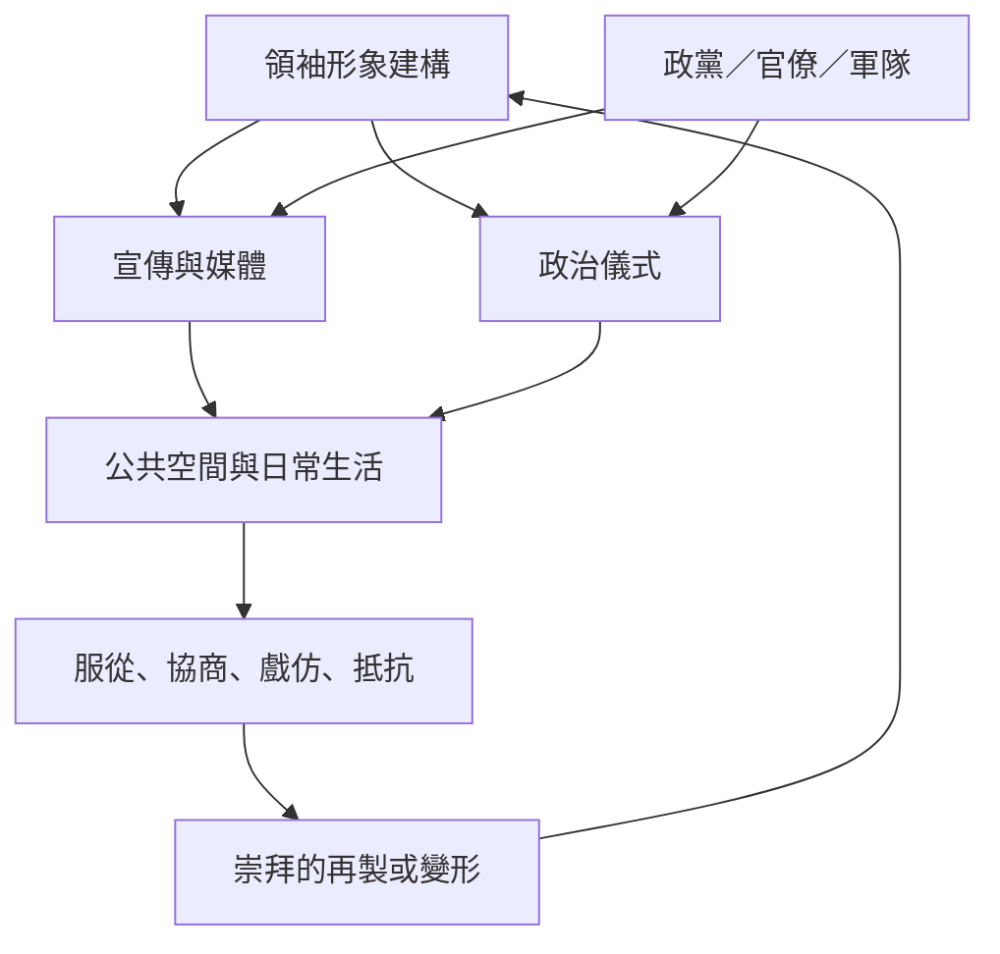

本圖整理領袖崇拜如何從領袖形象的生產，經由媒體、儀式和制度進入日常生活，並由民眾在服從、協商與抵抗之間持續再製。核心判斷是：崇拜不是宣傳圖像的總和，而是符號、制度與社會互動組成的權力關係。

核心筆記：[[領袖崇拜的核心是政治忠誠被個人化而非領袖單純受歡迎]]、[[領袖崇拜需要制度與群眾共同維持]]、[[領袖崇拜不以民眾真心相信為必要條件]]、[[領袖崇拜的強度不能只用肖像數量衡量]]。

概念入口：[[個人崇拜]]、[[宣傳]]、[[政治儀式]]、[[符號政治]]、[[公共偽裝]]、[[魅力型權威]]。
