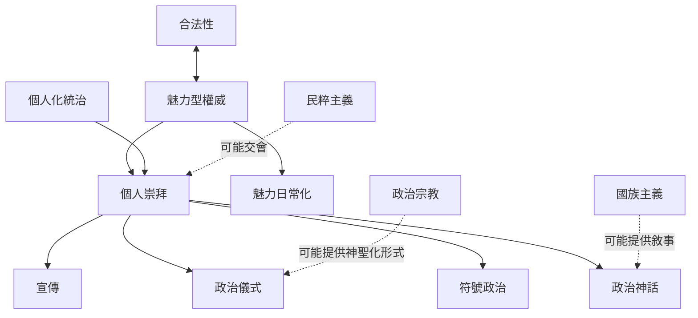

「個人崇拜」容易與魅力型權威、民粹主義、個人化統治、宣傳、政治宗教及國族主義混用。概念地圖的用途是避免把不同層次當成同義詞：魅力說明權威如何被承認；個人化統治說明權力如何組織；宣傳與儀式說明崇拜如何運作；政治宗教與國族主義說明神聖化及共同體敘事。

概念筆記：[[個人崇拜]]、[[領袖崇拜]]、[[魅力型權威]]、[[魅力日常化]]、[[個人化統治]]、[[符號政治]]、[[政治宗教]]、[[政治儀式]]、[[政治神話]]、[[宣傳]]、[[民粹主義]]、[[國族主義]]、[[合法性]]。
