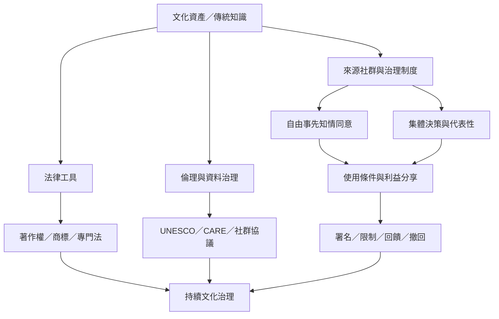

本地圖整理原住民族與地方社群面對文化使用、研究、典藏與商業化時的治理資源。法律保護、倫理原則、社群協議與資料治理各自處理不同面向，應互相補充而非互相取代。

相關概念：[[傳統知識]]、[[傳統文化表達]]、[[原住民族文化智慧財產]]、[[自由事先知情同意]]、[[集體同意]]、[[CARE 原則]]、[[文化治理]]、[[文化權利]]、[[利益分享]]、[[活文化遺產]]。

## 參考
* [[UNESCO 倫理原則要求文化合作建立在透明協商與自由事先知情同意上]]
* [[CARE 原則要求原住民族資料分享兼顧集體利益與自主治理]]
* [[澳洲第一民族藝術協議把自決與合作程序納入文化使用倫理]]
* [[Ka Mate haka 的法律治理顯示署名權不等於完整的文化治理權]]
* [[WIPO 2026 年傳統知識與文化表達談判仍未形成最終共同文本]]
