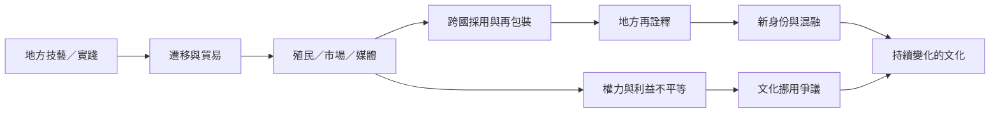

本地圖聚焦文化形式如何跨越地區、在殖民與全球市場中移動，再被地方社群重新詮釋。安卡拉布、Vlisco、瑜伽與和服案例顯示，文化身份不能只用起源地或製造地判定，必須同時追蹤使用者能動性、品牌與市場控制，以及地方歷史。

相關概念：[[跨文化混融]]、[[文化混雜]]、[[文化真實性]]、[[族群生成]]、[[文化 transpropriation]]、[[殖民主義]]、[[文化帝國主義]]、[[東方主義]]、[[文化商品化]]。

## 參考
* [[拉丁美洲的族群生成經驗要求重新思考文化挪用的普遍定義]]
* [[安卡拉布印花的跨洲歷史說明文化身份不等於製造地]]
* [[Vlisco 布料的非洲化與再荷蘭化揭示文化身份的多重歸屬]]
* [[印度瑜伽的全球流動呈現文化再挪用與地方再詮釋]]
* [[波士頓美術館和服爭議顯示文化欣賞與挪用並非二選一]]
