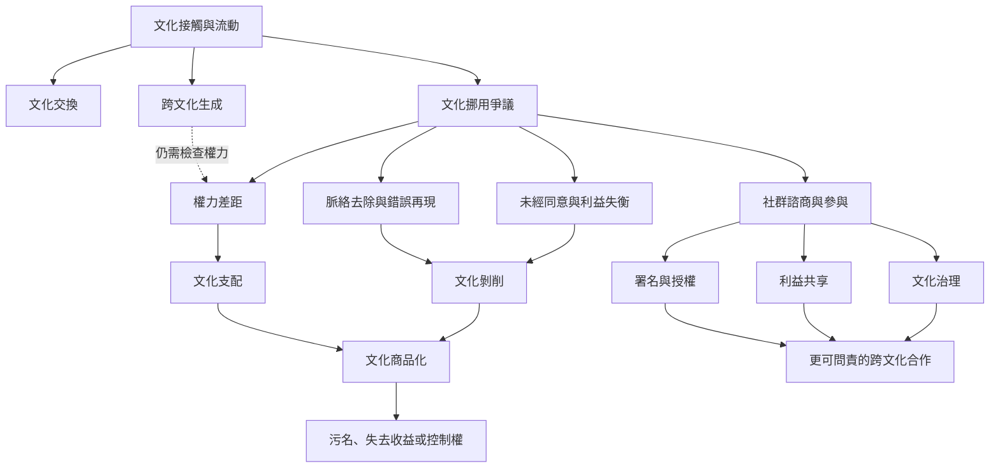

這張地圖把文化挪用整理成一個關係分析框架：從文化接觸出發，檢視借用是否在權力差距下轉化為支配或剝削，再觀察社群參與、署名、同意與收益分配能否改善關係。文化流動與文化權利不是互斥命題。

## 雙向連結
* 理論：[[文化挪用]]、[[文化交換]]、[[跨文化生成]]、[[文化支配]]、[[文化剝削]]。
* 權力與脈絡：[[殖民主義]]、[[東方主義]]、[[文化本質主義]]、[[文化商品化]]。
* 倫理治理：[[自由事先知情同意]]、[[署名]]、[[利益共享]]、[[傳統文化表達]]。
* 核心見解：[[文化挪用的判斷應同時考量權力脈絡與具體傷害]]、[[文化不是邊界封閉的所有物但文化流動仍可能不平等]]。
