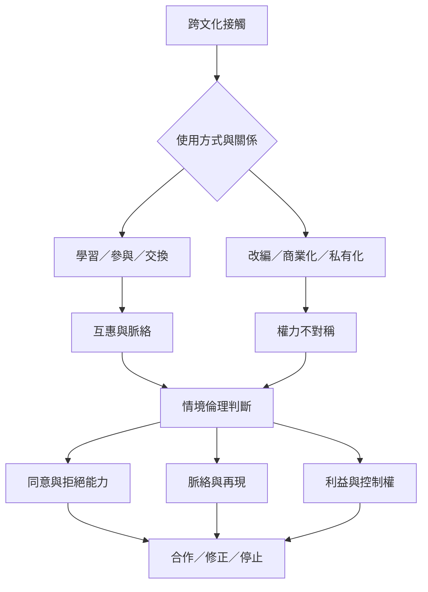

本地圖整理文化挪用的概念光譜與倫理判斷路徑：先分辨文化交流、採用與混融，再檢視權力不對稱、同意、脈絡、誤表與利益分配。它適合做為閱讀理論文獻與分析個案的入口。

相關概念：[[文化挪用]]、[[文化欣賞]]、[[文化交換]]、[[文化剝削]]、[[文化支配]]、[[跨文化混融]]、[[權力不對稱]]、[[文化商品化]]、[[互惠]]、[[利益分享]]。

## 參考
* [[文化挪用必須放回權力關係與跨文化流動中分析]]
* [[跨文化採用是一條光譜而非單一開關]]
* [[文化挪用的錯誤程度會被權力差距與獲利等因素放大]]
* [[文化挪用沒有一條能適用所有社會的固定分界線]]
