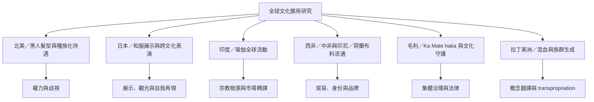

本地圖以具體案例連結全球區域脈絡，提醒研究者不要把單一地區的標準直接套用到其他社會。案例不是用來判定整個文化群體的固定立場，而是用來比較不同的歷史、制度、文化資源與權力關係。

相關概念：[[文化挪用]]、[[跨文化混融]]、[[權力不對稱]]、[[東方主義]]、[[文化商品化]]、[[族群生成]]、[[文化治理]]。

## 參考
* [[黑人髮型的挪用爭議與日常歧視必須一起理解]]
* [[波士頓美術館和服爭議顯示文化欣賞與挪用並非二選一]]
* [[印度瑜伽的全球流動呈現文化再挪用與地方再詮釋]]
* [[安卡拉布印花的跨洲歷史說明文化身份不等於製造地]]
* [[毛利 haka 的商業使用凸顯傳統知識與現代智慧財產法的落差]]
* [[拉丁美洲的族群生成經驗要求重新思考文化挪用的普遍定義]]
