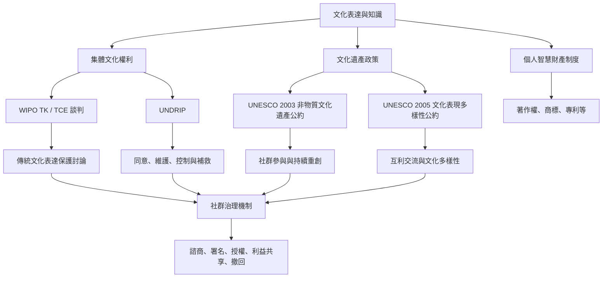

文化挪用涉及多個制度層次：著作權與商標等既有智慧財產工具、原住民族集體權利、文化遺產保存、社群自身的慣習規則，以及商業合作中的同意與利益共享。任何單一法律工具都難以涵蓋所有問題。

## 雙向連結
* 國際規範：[[聯合國原住民族權利宣言支持原住民族維護並控制文化知識表達]]、[[UNESCO公約把文化保存與互利的跨文化交流並列]]。
* 智慧財產：[[WIPO指出傳統文化表達的公有領域定位容易造成未經授權挪用]]、[[傳統文化表達的法律保護仍存在制度缺口]]。
* 制度實例：[[《Ka Mate》法案以承認與署名而非全面禁用回應毛利文化權利]]、[[澳洲原住民藝術倫理採購指南要求追溯作者社群報酬與來源]]。
* 實作：[[文化合作前的十個問題能降低無意識挪用]]、[[文化商品採購應追問作者授權報酬與社群受益]]。
