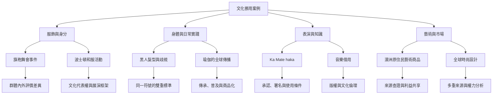

這張地圖將服飾、身體風格、音樂、瑜伽、表演與原住民藝術放在一起比較。案例的目的不是替所有文化建立通用規則，而是觀察同一組問題如何隨歷史、社群、制度與商業情境而改變。

## 雙向連結
* 服飾與博物館：[[旗袍舞會事件顯示文化來源群體內外的評價並不一致]]、[[波士頓和服活動顯示文化認同與代表權會隨情境改變]]。
* 身體與實踐：[[髮型研究指出主流社會可能同時排斥原群體並獎勵挪用者]]、[[瑜伽訪談指出文化傳承殖民經驗與當代普及必須一起考量]]。
* 表演與藝術：[[《Ka Mate》法案以承認與署名而非全面禁用回應毛利文化權利]]、[[音樂借用研究指出版權規則不能完全取代文化倫理判斷]]。
* 市場與制度：[[澳洲原住民藝術倫理採購指南要求追溯作者社群報酬與來源]]、[[全球時尚研究指出文化設計的來源網絡複雜但權力失衡仍需處理]]。
