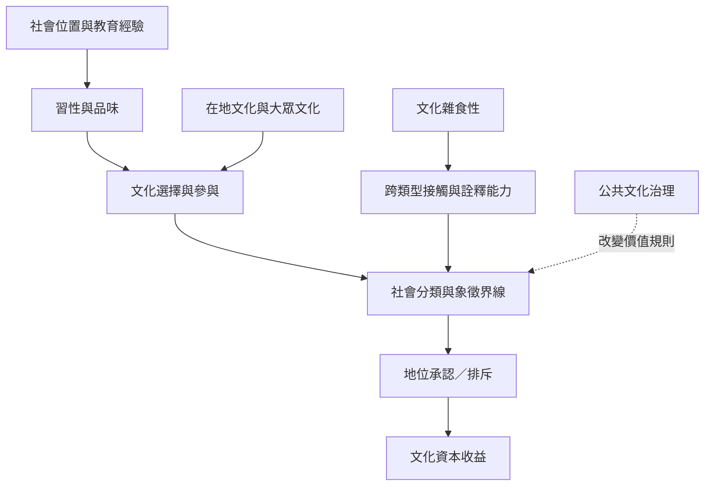

品味不只是個人的心理偏好，也可能是社會分類與群體區隔的工具。文化形式、參與方式與談論能力會在特定場域取得價值；當文化雜食性增加，區隔方式也可能從排斥轉向更複雜的跨文化能力展示。

法國的經典研究[[data/法國品味研究說明文化偏好也是社會區隔的實踐]]建立理論基礎；美國後續研究[[data/文化品味逐漸從勢利排斥轉向多元兼容仍可維持地位差異]]則呈現品味型態轉變。日本量化研究[[data/日本文化資本研究顯示測量方式必須貼近當地文化實踐]]提醒不能跨國直接套用同一份品味清單。

## 思與行
* 分辨文化多元與權力平等：節目多元不代表參與者有決策權。
* 讓不同文化實踐共同進入公共場域，並讓其實踐者參與詮釋與策劃。

## 參考
* [[note/文化資本不是固定的高雅文化清單]]、[[note/文化多樣性不會自動消除文化階序]]。
