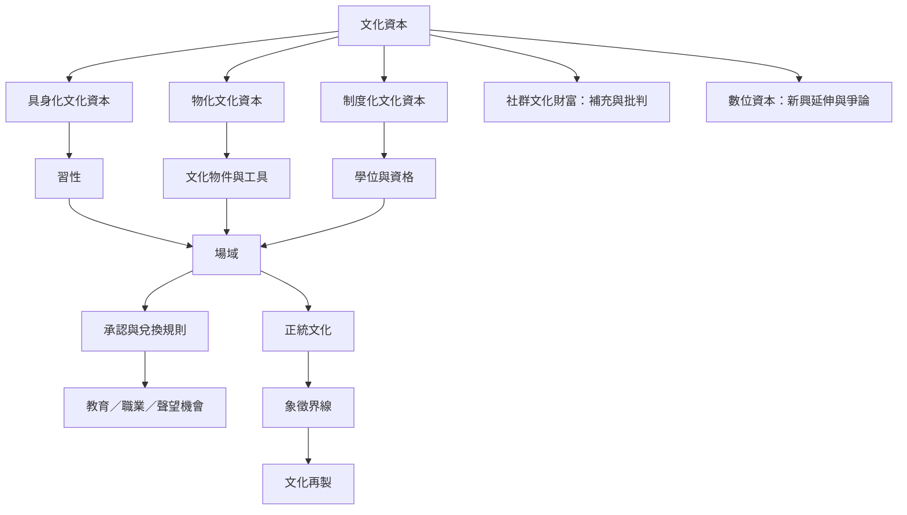

文化資本的分析需要同時看資源、持有者、制度規則與轉換結果。以下地圖由 Bourdieu 的三種資本形態，連到習性、場域、正統文化與文化再製，再延伸到社群文化財富及數位資本。

閱讀時先理解[[term/文化資本]]與三種形態，再看[[term/習性]]如何連接日常行動、[[term/場域]]如何設定承認規則。接著閱讀[[note/文化資本必須依照場域規則才能轉換成優勢]]、[[note/具身化物化與制度化資本之間存在時間與認證成本]]與[[note/文化資本的價值取決於誰有權定義正統文化]]。

## 思與行
* 用這張圖分析一個具體制度：標示資源持有者、承認者、規則與兌換結果。
* 將[[term/社群文化財富]]與[[term/數位資本]]視為理論對話與延伸，而不是把不同研究者的定義混成同一概念。

## 參考
* [[data/文化資本可透過具身化物化與制度化三種形態累積與轉換]]、[[data/文化資本的定義必須連結文化排斥與具體社會情境]]。
* [[note/文化資本必須依照場域規則才能轉換成優勢]]、[[note/數位資本可能是文化資本的延伸也可能是獨立資本]]。
