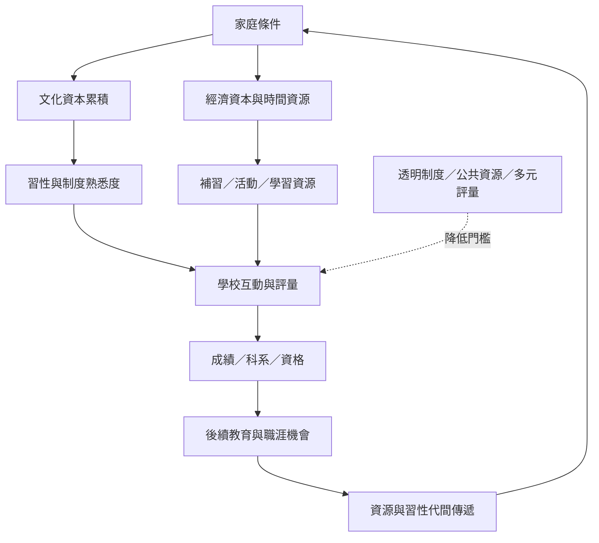

教育再製不是只靠學費與家庭收入運作，也透過語言互動、家庭時間、資訊取得、學校評量與升學路徑選擇形成。以下關係圖將家庭累積、學校承認、教育結果與代間延續放在同一個過程中。

核心研究包括美國家庭民族誌[[data/家庭教養方式會使中產兒童更熟悉制度互動規則]]、台灣教育資料[[data/台灣家庭文化資本與學生學業表現存在顯著關聯]]、中國專業選擇研究[[data/中國城市與農村學生的專業選擇受家庭文化資本影響]]及南韓補習市場[[data/南韓補習市場把家庭資源轉成教育競爭優勢]]。

## 思與行
* 追蹤教育歷程全段，不只看入學，也看科系選擇、留校、實習與畢業轉換。
* 介入點可包括制度資訊透明化、公共學習資源、多元評量與不依賴家庭人脈的諮詢。

## 參考
* [[note/家庭透過日常習慣傳遞可被制度辨識的文化資本]]、[[note/教育評價可能把階級熟悉度誤認為個人能力]]、[[note/文化資本影響的不只是入學也包括教育路徑的選擇]]。
