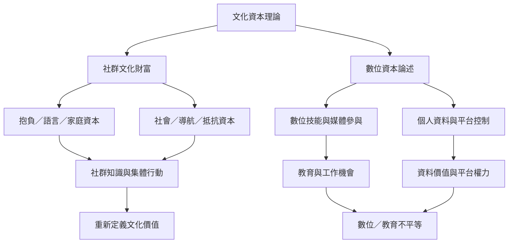

文化資本理論受到兩個方向的補充：其一是從邊緣社群的知識與抵抗經驗出發，指出未被主流承認的資源仍有價值；其二是分析數位平台、技能與個人資料如何形成新的資源及不平等。兩者都迫使研究者重新思考：資本由誰定義、誰能控制、如何轉換？

Yosso 的理論[[data/社群文化財富框架讓邊緣社群的知識不再被視為缺陷]]，與數位研究[[data/數位技能是否能成為資本取決於學校如何辨識與承認]]、[[data/數位資本的分配與資料經濟會延續階級不平等]]，可並置閱讀。歐洲身心障礙藝術組織研究[[data/社群與藝術組織能重新協商身心障礙者的文化參與資格]]則提醒，資本形成也受參與條件與身體差異影響。

## 思與行
* 用資產導向方法盤點社群既有知識，同時追問其是否受到制度承認。
* 將數位素養與資料權利並列，避免只把使用技能當成數位平等。
* 讓社群參與改寫文化場域規則，而非只提供既有文化內容的消費入口。

## 參考
* [[note/社群文化財富能補足只看主流認可的文化資本框架]]、[[note/數位資本可能是文化資本的延伸也可能是獨立資本]]、[[note/文化資本的累積也取決於文化機構是否允許不同身體參與]]。
