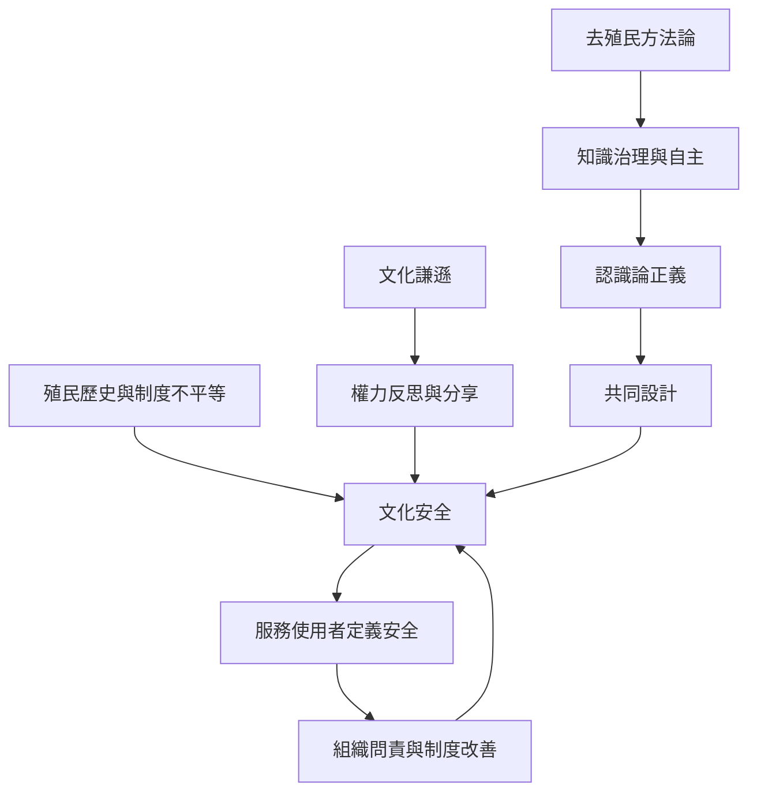

此圖由文化安全的歷史脈絡出發，連結權力反思、原住民族自主、知識治理與共同設計。文化安全不是通用文化技巧的升級版，而是要求專業制度回應具體歷史傷害與當事人對安全的判斷。

Aotearoa 紐西蘭、加拿大、澳洲與台灣的政策和研究各有不同歷史與治理情境，不能將一地的原住民族經驗當成另一地的普遍模板。閱讀時可從[[文化安全的判準應由接受服務者定義]]、[[去殖民研究必須重新分配知識治理的權力]]出發。

概念連結：[[文化安全（Cultural safety）]]、[[文化謙遜（Cultural humility）]]、[[去殖民方法論（Decolonizing methodologies）]]、[[認識論正義（Epistemic justice）]]、[[共同設計（Co-design）]]、[[交織性（Intersectionality）]]。
