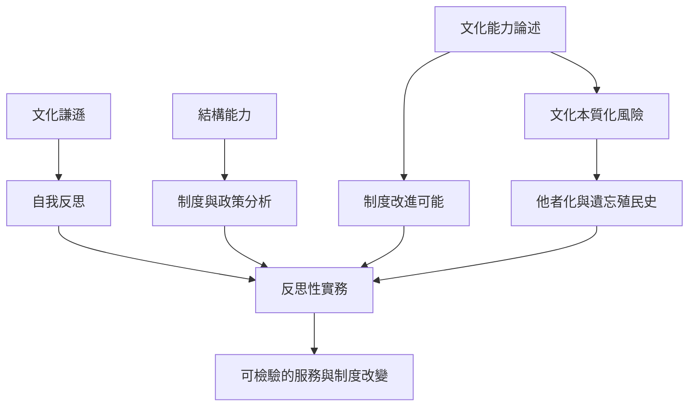

文化能力具有實務價值，也有本質化文化、遮蔽殖民史與將結構問題個人化的風險。批判不應簡化成全面接受或全面拋棄，而是持續追問概念如何運作、誰受益、誰被分類，以及實務是否真的改變。

批判的功能不是讓實務者陷入術語之爭，而是讓每個概念都接受脈絡與後果的檢驗。參照[[文化交流能力不等於把差異管理成可預測類型]]與[[跨文化實務應持續檢視自身論述與實際權力關係]]。

概念連結：[[文化能力（Cultural competence）]]、[[文化謙遜（Cultural humility）]]、[[結構能力（Structural competence）]]、[[文化自我反思（Reflexivity）]]、[[去殖民方法論（Decolonizing methodologies）]]。
