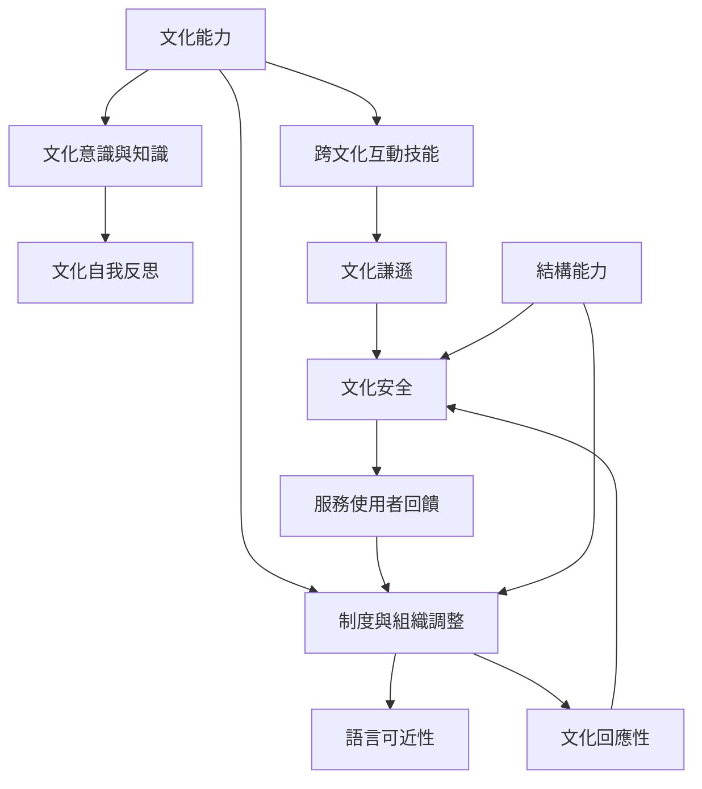

本圖將文化能力視為由個人學習、互動能力、組織制度與服務使用者經驗共同構成的動態系統。核心不是把人分類，而是讓制度能持續回應具體的人與情境。

文化能力可以提供制度設計的起點，但必須由[[文化謙遜將專家姿態轉為持續自我反思與權力調整]]補入持續修正，由[[文化安全的判準應由接受服務者定義]]確認判準，並由[[組織責任必須嵌入治理流程與問責機制]]避免改善只依賴個人熱忱。

概念連結：[[文化能力（Cultural competence）]]、[[跨文化能力（Intercultural competence）]]、[[文化謙遜（Cultural humility）]]、[[文化安全（Cultural safety）]]、[[結構能力（Structural competence）]]、[[文化回應性（Cultural responsiveness）]]、[[語言可近性（Language access）]]。
