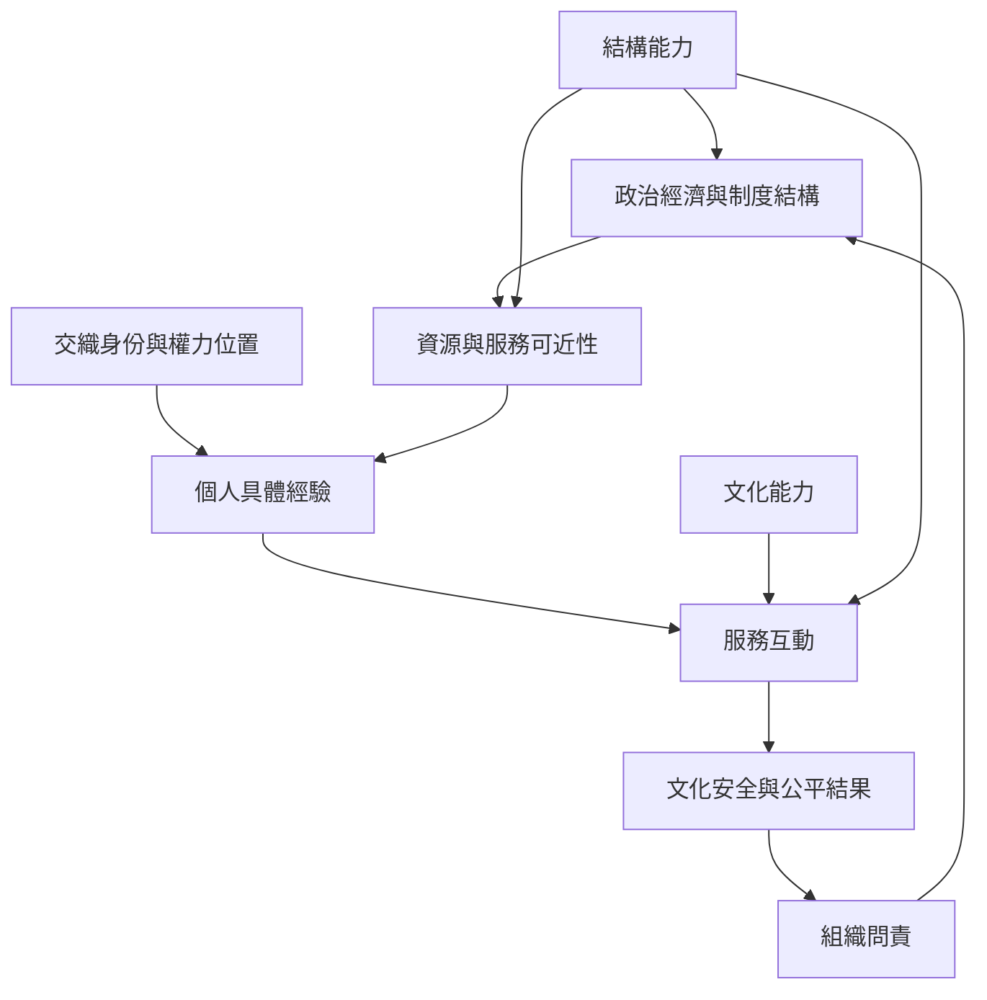

本圖說明個人互動並非發生在真空之中。結構能力、交織性與組織問責共同檢視資源、法律、地理、種族化與制度流程如何形塑服務經驗。

實務上應避免把制度障礙重新描述為服務對象的文化特質。可由[[文化敏感訓練不能替代結構改革]]開始，搭配[[文化能力需要同時回應交織身份和制度位置]]。

概念連結：[[結構能力（Structural competence）]]、[[交織性（Intersectionality）]]、[[組織責任（Organizational accountability）]]、[[文化安全（Cultural safety）]]、[[文化回應性（Cultural responsiveness）]]。
