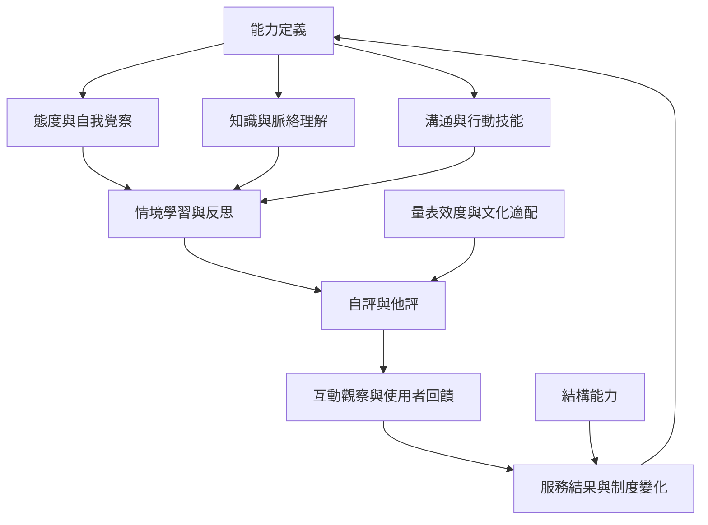

此圖將教育介入視為循環：定義能力、設計學習、情境練習、評估近端變化，再追蹤實際服務及使用者結果。量表只是證據來源之一，必須與觀察、訪談和使用者回饋搭配。

讀者可先看[[跨文化能力可透過態度知識技能與反思性互動共同理解]]，再比較[[文化能力評量必須同時觀察學習者與服務結果]]與[[跨文化能力測量需要先確認構念是否適用於新情境]]。

概念連結：[[跨文化能力（Intercultural competence）]]、[[文化智商（Cultural intelligence）]]、[[文化技能（Cultural skill）]]、[[文化適配（Cultural adaptation）]]、[[跨文化能力評量（Intercultural competence assessment）]]。
