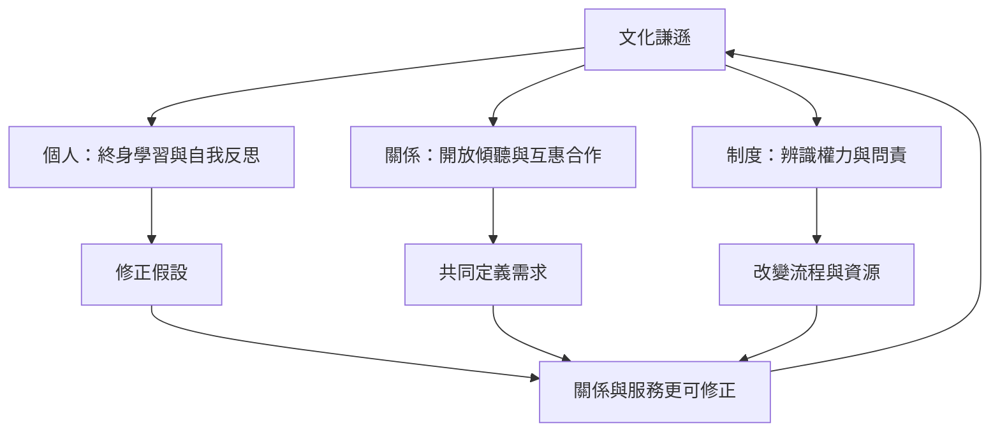

文化謙遜的核心並非熟知他者，而是持續反思自己如何參與權力關係，並將學習轉化為互惠、可問責的行動。可用「個人—關係—制度」三個層次理解：個人層次處理假設與偏見；關係層次處理傾聽、信任與共同決策；制度層次處理資源、規則與問責。

## 關係圖

## 雙向連結
* [[文化謙遜]]
* [[自我反思]]
* [[權力不對等]]
* [[制度問責]]
* [[文化謙遜是一種持續關係實踐而非文化知識終點]]
* [[自我反思必須連結權力結構才不會退化成自我感覺]]

## 參考
* [[Cultural_humility]]
