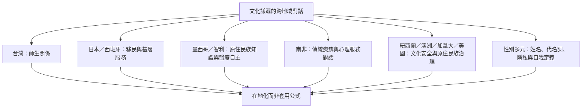

文化謙遜概念起源於美國醫療教育，但其問題意識可與全球各地對殖民權力、原住民族自主、移民服務、性別多元及教育關係的研究對話。這些案例不能被當成同一種文化謙遜模型的複製品；應尊重各地自身歷史、制度與知識傳統。

## 關係圖

## 雙向連結
* [[文化謙遜的全球實踐場域]]
* [[台灣國中研究顯示教師尊重與師生關係和學生適應相關]]
* [[墨西哥原住民族與研究者透過互惠對話共同改善孕產照護]]
* [[南非跨文化訓練可透過西方心理學與非洲療癒知識對話]]
* [[智利馬普切健康制度顯示跨文化政策也可能延續殖民權力]]

## 參考
* [[Cultural_humility]]
