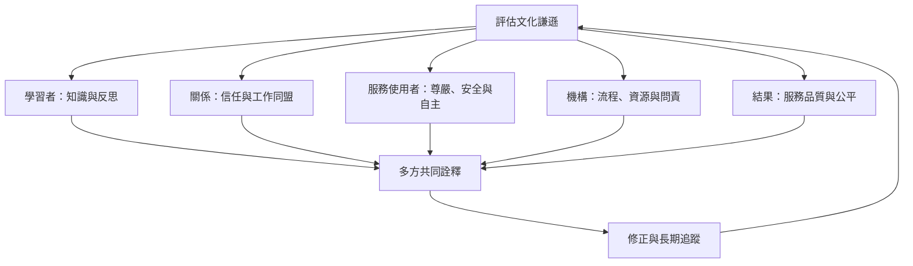

文化謙遜的研究評估必須區分知識、態度、互動行為、服務使用者經驗、組織流程與健康／公平結果。現有研究常使用自陳問卷或短期前後測，容易受社會期許、選擇偏差及缺乏追蹤影響。更完整的評估應由社群參與設計，結合多方資料並關注制度改變。

## 關係圖

## 雙向連結
* [[文化謙遜的成效需多方評估避免自評偏誤]]
* [[文化謙遜研究工具必須清楚說明測量的是哪一層次]]
* [[當事人感受到的謙遜能預測更好的治療合作關係]]
* [[文化謙遜研究與評估]]
* [[制度問責]]

* [[2026年原住民族文化安全介入回顧把受照護者經驗放在評估核心]]

## 參考
* [[Cultural_humility]]
