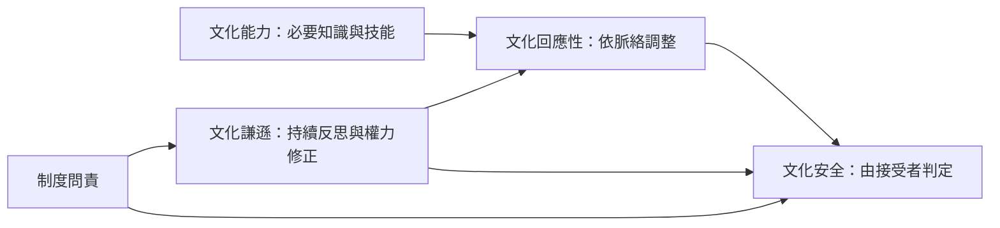

文化謙遜與文化安全高度相關但並不相同。前者關心提供者及機構是否持續反思和修正；後者關心接受服務者是否實際感到安全、尊嚴與自主。文化能力可提供必要知識，文化回應性則是依情境調整服務的實踐能力。四者應被放在同一個分析架構中，而非互相取代。

## 關係圖

## 雙向連結
* [[文化能力]]
* [[文化謙遜]]
* [[文化安全]]
* [[文化回應性]]
* [[文化安全最終由接受服務者判定]]
* [[文化能力與文化謙遜應以互補方式而非二選一理解]]

## 參考
* [[Cultural_humility]]
