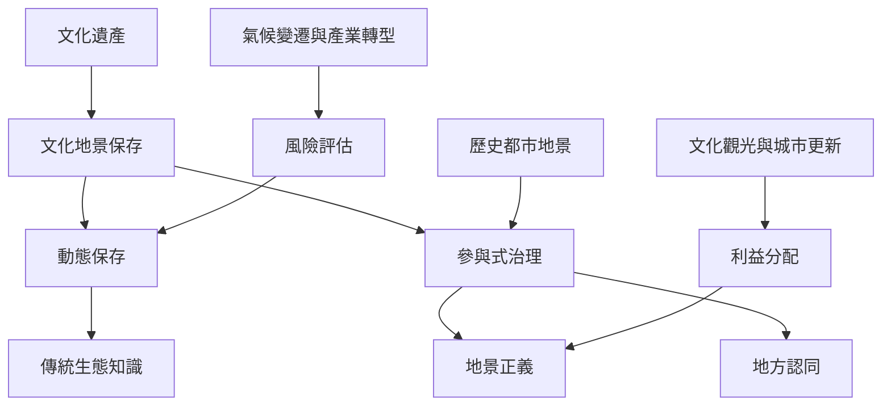

本圖把保存理解為面對變遷的治理實踐。參與式治理、地景正義與動態保存構成社群能否延續地方生活的關鍵；氣候風險、觀光壓力、都市更新及產業轉型則要求保存計畫持續檢視其社會與生態後果。

## 概念索引
[[文化地景]]、[[文化景觀保存]]、[[動態保存]]、[[參與式治理]]、[[地景正義]]、[[地方認同]]、[[傳統生態知識]]、[[歷史都市地景]]、[[文化遺產]]、[[公共資源]]

## 關係圖

## 永久筆記
* [[持續演化地景的真實性依賴活態實踐而非外觀不變]]
* [[保存文化地景必須同時處理土地權與利益分配]]
* [[都市文化地景保存需要容納持續變動的生活系統]]
* [[氣候調適不能只保護地景物件而應維持地方關係]]
* [[地方保存的正當性來自持續的社群關係而不只世界遺產標章]]

## 文獻筆記
* [[2026 年伊富高研究指出遺產觀光參與仍可能停留在象徵層次]]
* [[FAO GIAHS 倡議以動態保存而非凍結方式維護農業遺產]]
* [[台灣文資法將文化景觀列為人與自然長期互動的法定類別]]
* [[西安宣言指出遺產環境包含社會精神與經濟脈絡]]
* [[歷史都市地景方法把建成環境放回整體城市生活系統]]
* [[文化遺產氣候調適研究仍缺少在地知識與成效評估]]
