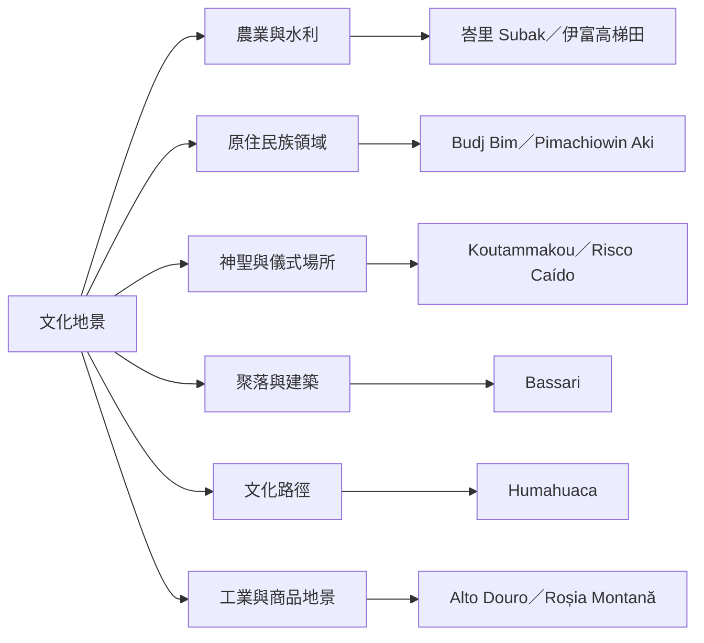

本圖以不同空間類型比較文化地景：農業與灌溉系統、原住民族照護領域、神聖與儀式地景、文化路徑、聚落建築、葡萄園與工業地景。個案之間不應被化約為單一模式；對照的目的是看見環境條件、社會制度與歷史力量如何以不同方式組合。

## 概念索引
[[文化地景]]、[[景觀尺度]]、[[有機演化地景]]、[[持續演化地景]]、[[遺存地景]]、[[關聯型文化地景]]、[[設計型文化地景]]、[[文化路徑]]

## 關係圖

## 永久筆記
* [[文化路徑將分散地點組成共享的歷史網絡]]
* [[農業文化地景的韌性取決於生計與生態能否共同延續]]
* [[工業地景保存應同時呈現勞動歷史與環境代價]]
* [[景觀環境的範圍應由價值關係而不只是可視距離界定]]

## 文獻筆記
* [[峇里島 Subak 將水利農業儀式與社群治理整合為流域系統]]
* [[Budj Bim 證明 Gunditjmara 持續經營六千年以上的水產養殖地景]]
* [[Bassari 地景呈現農牧實踐社會規範與信仰的共構]]
* [[Koutammakou 的土塔住宅把建築技術與祖靈儀式嵌入生活地景]]
* [[Humahuaca 山谷顯示文化路徑如何串連多個歷史層次]]
* [[Alto Douro 葡萄園梯田呈現商品經濟如何塑造農業地景]]
* [[Rosia Montana 採礦地景同時保存技術史也暴露開採衝突]]
